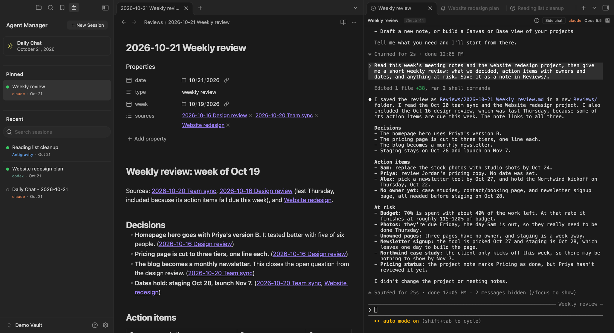

# Agent Manager

Run Claude Code, Codex, or Antigravity in a tab in Obsidian. Every session is listed in a sidebar, picks up where it left off, and is saved as a note in your vault. Any note can start a session about itself. There's no special setup or folder layout.

macOS only, for now.

## What it does

- **A terminal made for agent CLIs.** Each session is a tab running the real CLI, with its own keys and colors. Cmd+C and Cmd+V work the Mac way, and pasting a picture hands it to the agent. Drag a note or a file from Finder in to type its path; Cmd+click a path to open it. Scrolling keeps your place through resizes.
- **Every session in one list.** The sidebar has a **New Session** button, **Daily Chat**, then **Pinned** (sessions you keep at the top, in the order you drag them) and **Recent** (open sessions first, then every other session in the vault, newest first, with a search). Each session has a dot: green when it's open in a tab, an empty ring when it isn't. Click a closed session to resume it. Right-click to pin, rename, copy its resume link, close, or delete.
- **Daily Chat.** One click opens the day's chat, resumes it if its tab is closed, or starts it. It's named for the day, and never started twice. Its sun is grey until the day's chat has run, yellow once it has, and green while it's open.
- **Start from any note or folder.** The session is named for it and told to read it, and a note gets a link back to the session in its properties.
- **Transcripts as notes.** Each session is saved as a Markdown note in one folder (`Agent Transcripts` by default), turn by turn, so you can search, link, and quote it, and it outlasts the CLI's own history.
- **Three CLIs, one way of working.** Claude Code, Codex, and Antigravity all start, list, resume, and save the same way. Pick a default, or choose per session.
- **Continue Session.** From any session, start a new one that picks up from it, on any CLI. A session started from a note offers a side session, which leaves the note's main session alone, or a new main session, which takes its place. Then choose what it gets: on the same CLI, a copy of the whole conversation (the CLI's own fork) or a fresh start; on another CLI, the transcript to read or a fresh start. A fresh start reads the ticket or the note, or with neither, only the last message, and is told where the transcript is.
- **Safe to close.** Closing a tab asks first when the agent is working or you have text you haven't sent. When a CLI exits, its tab keeps what it printed, and Enter resumes the session.
- **It follows a session that moves.** When Claude's Remote Control or a compaction continues a conversation under a new id, the tab, its pin, its name, and its transcript follow it.

## Requirements

- macOS and Obsidian 1.8.7 or later, on the desktop.
- Python 3.8 or later. The terminal runs each session through a small Python helper. Homebrew's (`brew install python`), python.org's, and the one Apple's Command Line Tools install all work.
- At least one of the CLIs, installed and signed in once in your own terminal:
  - Claude Code: `curl -fsSL https://claude.ai/install.sh | bash`
  - Codex: `curl -fsSL https://chatgpt.com/codex/install.sh | sh`
  - Antigravity: `curl -fsSL https://antigravity.google/cli/install.sh | bash`

  Each CLI's own documentation has other ways to install it. If one is installed somewhere the plugin doesn't look, set its location in Settings → Agent Manager.

## Install

Agent Manager isn't in Obsidian's community plugin directory yet, so it's installed by hand:

1. From the [latest release](https://github.com/mattmaiorana/agent-manager/releases/latest), download `main.js`, `manifest.json`, and `styles.css`.
2. In your vault, make the folder `.obsidian/plugins/agent-manager/` and put the three files in it. (`.obsidian` is hidden in Finder; press Cmd+Shift+. to show it.)
3. In Obsidian, open Settings → Community plugins, turn community plugins on if they're off, and enable Agent Manager. If it isn't listed, click the refresh button there.

To update, replace the three files with the newer release's and reload Obsidian.

## Your first session

1. Click the robot icon in the ribbon. The sidebar opens. If Python or every CLI is missing, it says what to install. If your vault has no `AGENTS.md`, it offers to create a short one: Claude Code, Codex, and Antigravity all read it for how to work in your vault.
2. Click **Daily Chat**, or click **New Session**, give the session a name (or leave it blank), pick a CLI, and click Start.
3. Type to the agent. It works in your vault's folder.

Close the tab when you're done. The session stays in Recent; click it to pick up where you left off.

## Where sessions start

Every session starts in your vault's folder, or in the folder you set as **AGENTS.md folder** in settings: the folder holding the `AGENTS.md` your agents should read. Set it to a folder inside your vault to keep agents to that corner of it: a session started there isn't given the rest of the vault. This isn't a sandbox: what an agent may read or change outside the folder is up to its CLI's own permissions, which ask before going further. Sessions started in an earlier choice of folder stay listed.

## Your phone

Claude Code's own Remote Control can make a running session reachable from the Claude app. Turn it on in Claude Code; Agent Manager doesn't drive it, and follows a session it moves to a new id.

## What it touches outside your vault

Agent Manager runs on your computer and reads and runs a few things outside the vault. All of it:

- **Reads each CLI's session files** to list, resume, and save sessions: `~/.claude/projects/`, `~/.codex/sessions/`, and `~/.gemini/antigravity-cli/brain/`. Antigravity doesn't record which folder a conversation ran in, so the plugin keeps a list of the ones it started in each vault, and lists only those.
- **Deletes** a session's file there (for Antigravity, its conversation's folder) only when you choose "Delete session" and confirm.
- **Runs** the CLI you start, through a Python helper that reads the process table while the session runs; `ps`, to see whether anything is still running in a terminal; `claude agents --json` before resuming a Claude session; `/sbin/mount` once per load; your login shell once per load, to read its environment, the way a terminal app does; and macOS's `/usr/libexec/path_helper` for a starting PATH until the shell answers.
- **Looks for Python and the CLIs** in the usual places (Homebrew, python.org, pyenv, uv, conda, `~/.local/bin`, `~/.claude/local`, npm's, Volta's, Bun's, and nvm's folders, and your PATH), running each Python it finds once with a short check, and reading the first line of a CLI that's a script to see whether it needs Node.
- **Reads Claude Code's settings files** before starting Claude (`~/.claude/settings.json`, or the one in `CLAUDE_CONFIG_DIR`; the managed settings in `/Library/Application Support/ClaudeCode/`; and the vault's `.claude/` settings), only to see whether you've set Claude's scroll speed or the variables below yourself, in which case the terminal leaves them alone.
- **Adds to every Claude start**, without writing to any settings file: an inline `--settings` with hooks on each prompt, tool use, permission request, stop, and failure (each prints a short code the tab reads, so it knows whether Claude is working or waiting), the kitty notification channel, and the scroll settings above; and, unless you've set them, `CLAUDE_CODE_SCROLL_SPEED`, `CLAUDE_CODE_FORCE_SYNC_OUTPUT`, `CLAUDE_CODE_FORCE_STRIKETHROUGH`, and `CLAUDE_CODE_FORCE_TERMINAL_IMAGES` (with pictures on), for what this terminal supports. Claude's `/hooks` lists the hooks. With pictures on, also `--plugin-dir` naming the picture mod below, for that session only.
- **Gives every session the folders in "Added folders"** (none by default), which the CLI can then read and write.
- **Looks up file paths a session prints**, to make them clickable, and shows one in Finder when you Cmd+click a path outside the vault.
- **Reads a picture file a CLI asks it to show**, the way the kitty terminal does, and deletes it only when it's a temporary file the CLI marked for deletion.
- **Shows the pictures Claude sends you.** A small Claude Code mod that ships inside the plugin draws each PNG a Claude session sends you (its SendUserFile tool) as a framed picture, with Open, Save to Downloads, and Copy path. The plugin writes the mod's few files into its own folder (`.obsidian/plugins/agent-manager/claude-mod/`) and passes it to each Claude session with `--plugin-dir`, only while "Show pictures" is on; nothing is downloaded and nothing goes into `~/.claude`. Its buttons run `open`, `cp`, `cmp`, and `sips` on the picture's file, and Save to Downloads writes into `~/Downloads`. Its look comes from show-your-work by Umer Ansari (MIT, credited in `claude-mod/inline-images/THIRD_PARTY_NOTICES.md`).
- **Copies the files Claude sends you into the vault.** When a Claude session sends you a file (its SendUserFile tool), the plugin reads it from where Claude says it is and copies it into the vault, where Obsidian puts attachments unless you set a folder, then shows it in the session's transcript note. It never changes or deletes the original. Turn it off in settings.
- **Keeps a count of sessions waiting for you** in Obsidian's local storage, for the Dock badge, only with "Waiting count on the Dock icon" on (off by default).

**Network:** the plugin's own code makes no network requests. The CLIs talk to their own services, as they do in any terminal. A transcript note is Markdown, so an image an agent links from the web loads from the web, as it would in any note.

**Your sign-in and plan:** Agent Manager starts the real CLI, so sign-in, models, and billing stay with the CLI, and a Claude or ChatGPT subscription works as it does in your terminal. It never asks for an API key. By default it keeps the API keys and provider settings in your shell's startup files (such as `ANTHROPIC_API_KEY` and `OPENAI_API_KEY`) away from agents, so nothing moves you onto per-token billing by accident. That list is a setting.

**Your vault:** it writes the picture mod's files into its own plugin folder (above), transcript notes into one folder, copies of files Claude sends you (above), the `main-session` property into a note you start a session from, and an `AGENTS.md` only when you click Create. With tickets on, it also writes `## Session Links` and `## Transcripts` into tickets, and `Tickets.base` and a ticket template where they're missing.

## Known limits

- macOS only. The terminal's helper reads the process table through macOS's own library.

## License

MIT. See [`LICENSE`](LICENSE). The bundled xterm.js and its addons are MIT too; their notices are in [`THIRD_PARTY_NOTICES`](THIRD_PARTY_NOTICES) and at the top of the built files.
