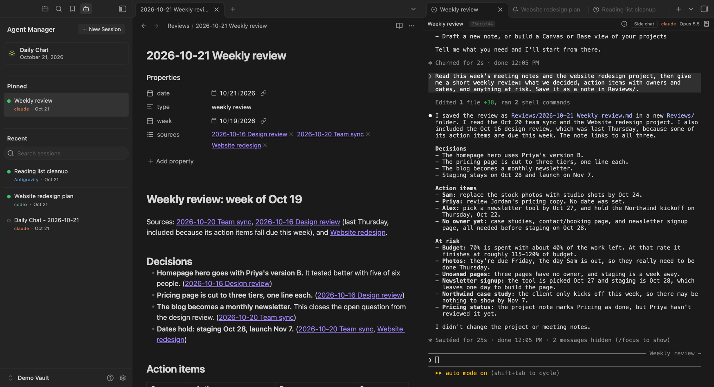

# Agent Manager

Run Claude Code, Codex, or Antigravity in a tab in Obsidian. Every session is listed in a sidebar, picks up where it left off, and is saved as a note in your vault. Any note can start a session about itself. There's no special setup or folder layout.

Desktop and macOS only, for now.

## What it does

- **The terminal.** Each full session runs the real CLI in a tab, with the CLI's own keys and colors. Cmd+C and Cmd+V work the Mac way, and pasting a picture hands it to the agent. Drag a note or a file from Finder in to type its path. Every path, note name, web address, and `obsidian://` link to a note or a session that opens is underlined; click one to open it (or Cmd+click, by a setting), and a name several notes share asks which (turn the underlines off in settings). Scrolling keeps your place through resizes.
- **The session list.** The sidebar has a custom button at the top right (with tickets on it opens your tickets, and you can give it an icon, text, and a note or link of your own), then a **Daily Chat** button, a **New Session** button whose card opens under it, a **New Ticket** button while tickets are on, then **Pinned** and **Recent**. Drag pinned sessions into the order you want. Recent lists open sessions first, then every other session in the vault, newest first, and you can search it. Each session has a dot: green when it's open in a tab, an empty ring when it isn't. Click a closed session to resume it. Right-click to pin, rename, copy its resume link, close, or delete.
- **Daily Chat.** One click opens today's chat: it resumes it if its tab is closed, and starts it if it hasn't run yet. It's named for the day and never started twice. Its sun is gray until the day's chat has run, yellow once it has, and green while its tab is open. Don't want it? Turn off Show the daily chat button in settings.
- **Start from a note or folder.** The session is named for it and told to read it, and a note gets a link back to the session in its properties.
- **What a session knows about where it started.** A session started from a ticket, note, or folder is told where that is, its project's overviews (with overviews on), the notes or folders a ticket lists in its `reads` property (links or vault paths, a folder named as a folder rather than opened up), and the repo the nearest overview names. Claude Code and Codex also keep these beside the conversation, so a compaction doesn't lose them; Antigravity has them in its first message only. A session keeps the paths it started with, so if one moves while it runs, it still has the old one (Claude takes up the new one after a resume and its next compaction). Hover the strip's note icon to see what a session has, and right-click it to open any of them.
- **Transcripts.** Each session is saved turn by turn as a Markdown note in one folder, `Agent Transcripts` by default. You can search, link, and quote it, and it outlasts the CLI's own history. A Claude session's sub-agents are saved too, each as a note in a folder named like the session's note beside it, linked from the session's note.
- **Three CLIs.** Claude Code, Codex, and Antigravity all start, list, resume, and save the same way. Pick a default, or choose per session.
- **Attaching to a ticket.** In a session tab's menu, "Attach to a ticket" lists the session in a ticket. "Attach to a ticket as its main session" also makes the ticket's Resume open it. A plain attach never changes the ticket's main session. "Make a ticket from this session" opens the New Ticket card with the session's project filled in, and attaches the session to the ticket it makes.
- **New tickets.** With tickets on, the New Ticket button opens a card: the ticket's name, its project, notes, and the CLI it starts on. Create makes the ticket in the project's Tickets folder and opens it; Launch also starts its main session.
- **Continue Session.** From any session, start a new one that picks up from it, on any CLI. A session started from a note offers a side session, which leaves the note's main session alone, or a new main session, which takes its place. Then choose what the new session gets:
  - On the same CLI: a copy of the whole conversation (the CLI's own fork), or a fresh start.
  - On another CLI: the transcript to read, or a fresh start.

  A fresh start reads the ticket or the note, or with neither, only the last message, and is told where the transcript is.
- **A plain terminal.** "Open terminal" in the command palette opens a shell with no agent in it, in your vault's folder; "Open terminal here" in a folder's menu opens one in that folder, and "Open terminal in this folder" in a session tab's menu, where the full session runs. It isn't a session, so it isn't listed or saved, and a reload starts a fresh shell.
- **Closing.** Closing a tab asks first when the agent is working or you have text you haven't sent. When a CLI exits, its tab keeps what it printed, and Enter resumes the session.
- **Unsent text survives a reload** (Claude Code and Codex sessions, for now). What you've typed into a session and not sent is saved with its tab, and put back in the prompt, unsent, after Obsidian or the plugin reloads or quits unexpectedly. If it can't go back (you started typing first, say), it's dropped, or with **Copy unsent text that can't be put back** on, copied to the clipboard. It's kept in your vault's workspace file (`.obsidian/workspace.json`) until you send or clear it or close the tab. Turn it off with **Keep unsent text through a reload**.
- **Agent profiles (optional).** Most vaults don't need them: one session can do any kind of work, and overviews organize it by project. A profile keeps things apart, such as work and personal, when each needs its own instructions and reference files. You don't need one per role. Profiles aren't access control: every session can still read the same files.

  To use them, turn on Use agent profiles in settings and add one: a name, a note with its instructions, and an agent folder (optional). Claude Code and Codex get the instructions when the session starts, and every CLI is told about them in its first message. A session started from a note in a profile's agent folder uses that profile. For other sessions, a switch at the top of the sidebar picks the profile, and the sidebar then lists only that profile's sessions. Each profile has its own Daily Chat and transcripts folder. Every session is an agent either way: a profile only sets who it starts as, and a session with no profile can still do everything.
- **Moved sessions.** When Claude's Remote Control or a compaction continues a conversation under a new id, its tab, pin, name, and transcript go with it.

## Requirements

- macOS and Obsidian 1.8.7 or later, on the desktop.
- Python 3.8 or later. The terminal runs each session through a small Python helper. Homebrew's (`brew install python`), python.org's, and the one Apple's Command Line Tools install all work.
- At least one of the CLIs, installed and signed in once in your own terminal:
  - Claude Code: `curl -fsSL https://claude.ai/install.sh | bash`
  - Codex: `curl -fsSL https://chatgpt.com/codex/install.sh | sh`
  - Antigravity: `curl -fsSL https://antigravity.google/cli/install.sh | bash`

  Each CLI's own documentation has other ways to install it. If one is installed somewhere the plugin doesn't look, set its location in Settings → Agent Manager.

## Install

Agent Manager is in Obsidian's community plugin directory: open Settings → Community plugins → Browse, search for Agent Manager, and install it. Or install it by hand:

1. From the [latest release](https://github.com/mattmaiorana/agent-manager/releases/latest), download `main.js`, `manifest.json`, and `styles.css`.
2. In your vault, make the folder `.obsidian/plugins/agent-manager/` and put the three files in it. (`.obsidian` is hidden in Finder; press Cmd+Shift+. to show it.)
3. In Obsidian, open Settings → Community plugins, turn community plugins on if they're off, and enable Agent Manager. If it isn't listed, click the refresh button there.

To update, replace the three files with the newer release's and reload Obsidian.

## Your first session

1. Click the robot icon in the ribbon. The sidebar opens. If Python or every CLI is missing, it says what to install.
2. If your vault has no `AGENTS.md`, the sidebar offers **Set up this vault** (below). Claude Code, Codex, and Antigravity all read `AGENTS.md` for how to work in your vault. Or dismiss it and start right away.
3. Click **Daily Chat**, or click **New Session**, give the session a name (or leave it blank), pick a CLI (and an agent profile, if you use them), and click Start.
4. Type to the agent. It works in your vault's folder.

Close the tab when you're done. The session stays in Recent; click it to pick up where you left off.

## Setting up your vault (experimental)

**Set up this vault** starts a session named "Vault setup" on your default CLI, to help you set the vault up for agents. It asks what the vault is for and what's off limits. Then it offers git, and explains it plainly: a hidden folder that keeps a copy each time a session saves its work, so anything saved can be rolled back, and nothing goes online. Then it asks how you'd like to work: step by step, or on its own.

It looks around, tells you what it found, and sets up what's missing: an `AGENTS.md`, a commit rule if you're using git, and a rule for where files go. If you'd like them, it also offers an example project that shows how projects and tickets work, suggestions for which of your own folders could be projects, tickets with a first ticket, a rule to write things down as they happen, a skills folder, the starter skills (below), agent profiles, and a folder for your conventions.

Step by step, it asks about each one in turn and changes something only when you say yes. On its own, it asks you to turn on tickets, then makes the basics, the example project with a sample ticket, a ticket for the setup itself, and the starter wrap skill, all as new files. One click makes the setup session that ticket's main session, so setup ends as a real, finished ticket you can resume. Then it reports any change it would make to files you already had, and everything it left out.

Either way, it asks before deleting, moving, or changing anything already in your vault, before installing git or making its first commit, and before bringing in anyone else's code. Settings stay yours to change. Close it whenever you like and resume it later. Run it again and it offers only what's left.

It's in the sidebar while your vault has no `AGENTS.md`, under **Advanced & experimental** in settings, and in the command palette. It stays experimental: an AI agent does the work, so results vary with the CLI and model you use. Its instructions are a file the plugin keeps in its own folder, [`guides/vault-setup.md`](guides/vault-setup.md), which you can also read, or paste into any session yourself.

## Starter skills

The [`skills/`](skills/) folder has two skills you can copy into your own skills folder and change however you like:

- **wrap** ends a session with a summary of what was done and what's open, and files it in the session's ticket.
- **second-opinion** has another company's CLI review a draft or a plan, as close to read-only as each CLI allows. It sends what the reviewer reads to that reviewer's company, and its `SKILL.md` says what each CLI's reviewer can and can't be kept from.

Each runs only when you ask for it (`/wrap` in Claude Code and Antigravity, `$wrap` in Codex). Set up this vault offers to copy them. The plugin keeps the originals in its own folder (`.obsidian/plugins/agent-manager/skills/`) and rewrites them on each update, but never touches your copies, so a newer version won't reach a copy you've made: check here for one.

Also recommended: [obsidian-skills](https://github.com/kepano/obsidian-skills) by Steph Ango (kepano), Obsidian's CEO, which teach agents Obsidian's own formats (Bases, Canvas, Obsidian-flavored Markdown) and its command line. They also include a web page reader built on the `defuddle` command, which isn't installed with them, so an agent may ask to install it (`npm install -g defuddle`) the first time it reads a page. Install them by their own instructions.

## Tips for each CLI

A few of each CLI's own commands worth knowing. They change the CLI's settings, not your vault, and they move between releases, so check each one's `/help`.

- **All three:** `/usage` shows how much of your plan's limits is left (Codex's needs a ChatGPT sign-in), and `/statusline` chooses what the line under the prompt shows.
- **Claude Code:** `/config` is the settings panel. "Enable Remote Control for all sessions" there lets you follow and continue any session from the Claude app (it needs a claude.ai subscription). `/focus` shows only your last prompt, a one-line summary of what was done, and the final answer; `/focus` again turns it off.
- **Codex:** its settings live in `~/.codex/config.toml`. `/permissions` chooses what Codex may do without asking, `/theme` picks a color theme, and `/experimental` lists features you can switch on.

## Keyboard shortcuts

The terminal passes every key to the CLI as Terminal.app would, except these, which work the Mac way. "In Claude's input" means the box you type in, in Claude Code's full screen; Claude keeps its own selection there, which the terminal can't see, so Agent Manager makes these by sending Claude the clicks and keys that would.

**Anywhere in the terminal**

| Keys | What they do |
|---|---|
| Cmd+C | Copy the selection (never interrupts) |
| Ctrl+C | Copy when something is selected, else interrupt (a setting makes it always interrupt) |
| Cmd+V | Paste text; a picture on its own is handed to the agent |
| Cmd+X | Copy (and cut, in Claude's input) |
| Escape | With something selected, clear the selection instead of interrupting |
| Cmd+F, Cmd+G, Shift+Cmd+G | Find, next, previous |
| Cmd+K | Clear the scrollback (in Claude's full screen, redraw it) |
| Cmd+Home, Cmd+End (Cmd+Fn+Left, Cmd+Fn+Right) | Top or bottom of the scrollback |
| Cmd+Up, Cmd+Down | Previous or next prompt, in a shell that marks them |
| Page Up, Page Down (Fn+Up, Fn+Down) | Scroll the scrollback (Shift sends them to the program) |
| Cmd+Left, Cmd+Right | Start or end of the line |
| Option+Left, Option+Right | Back or forward a word |
| Cmd+Delete | Delete to the start of the line |
| Cmd+Fn+Delete | Delete to the end of the line |
| Option+Fn+Delete | Delete the next word |
| Cmd+Z | Undo the last edit in the prompt |
| Shift+Enter | New line in the prompt |

**In Claude's input**

| Keys | What they do |
|---|---|
| Cmd+A | Select everything typed |
| Shift+Left, Shift+Right | Select a character at a time |
| Shift+Up, Shift+Down | Select to the same place a row up or down |
| Typing, Cmd+V | Replace the selection |
| Delete, Fn+Delete | Delete the selection |
| Cmd+X | Cut the selection |

The cursor is a blinking line between characters, as in a text editor, so a selection visibly starts from it; the Cursor style setting offers a block or an underline instead, and blinking can be turned off. Shift+arrows start at the cursor or extend a selection made with the mouse (double click for a word, triple click for a line) or Cmd+A. Shift+Cmd+arrows and Shift+Option+arrows don't select: Claude has no word move, and selecting to a line's start or end didn't combine with Shift+Up and Shift+Down the way a text field's does.

## Where sessions start

Sessions start in your vault's folder, unless you set **AGENTS.md folder** in settings to the folder holding the `AGENTS.md` your agents should read. Set it to a folder inside your vault to keep agents to that corner of it: a session started there isn't given the rest of the vault. This isn't a sandbox: what an agent may read or change outside the folder is up to its CLI's own permissions, which ask before going further. Sessions started in an earlier choice of folder stay listed.

## Scheduled tasks (off by default)

A scheduled task is a prompt Agent Manager runs on a schedule with nobody watching: a morning roundup, a weekly review of your notes, a watch on a page. Turn them on in settings ("Use scheduled tasks"), then make one with **New Scheduled Task** on the sidebar's Scheduled Tasks page.

- **A task is a note** with `type: scheduled task` in its properties, in a folder of its own named like it. Its properties say when it runs (`schedule: Weekdays 7:00`, in plain words), how it runs (`mode`, below), and what a run may reach: `web` (off, search, or a list of sites), `reads` (the notes and folders a run starts with, as a ticket's are: a full session run is told to read them first and keeps them through a compaction; a headless run may read them and is given each note as text; one that names nothing is a problem on the task), and for a headless task `file-access` (how far it reaches beyond its own folder and its `reads`: none, its project, the whole vault, or the whole Mac, with folders elsewhere on this computer beside none, project, or vault, each starting with `~/` or `/`) and `tools`. Its project is where it sits: the nearest folder above it with an overview, so a scheduled task in `<project>/Scheduled Tasks/<Name>/` is that project's, and it moves and archives with it. With no overview above it, its own folder is its project, which is what it reads. There's no `project:` property. It runs as the agent whose agent folder holds it; one in your Scheduled Tasks folder, outside every agent folder, runs as no agent, with only your `AGENTS.md`. Two scheduled tasks can share a name, as tickets can: where they do, notices, notifications, and commits add where each sits in parentheses. What each run does goes under `## Prompt`; `## Human Notes`, first in the template, is for your own notes on it: a run is given them after its prompt, and they're approved with it. The note's header has Run now (Stop while it runs). Start session, on the scheduled task's page or in its right-click menu (or Start agent session on the note), opens a session to talk over its results or work on its prompt: it's told it's looking at a scheduled task and where its run log is, reads the results as information, and waits. Beside the note the plugin keeps `Run log.md`, `Outputs/` (each result, as a new note), and `Memory.md` (notes a run leaves for the next one).
- **Three kinds of task.** The New Scheduled Task card asks which, says in a sentence what each does, and writes it into the note: **Full session** (the default), **Headless (Local Only)**, or **Headless (Web Access)**. In the note that's `mode: full` or `mode: headless`, and for a headless task, `web` off or on. A task with no `mode` is headless. A full session task runs as an ordinary Claude Code session, with a few things refused. A headless task is locked down: with the web off, nothing can leave your Mac, so it can reach the most here (its project, folders outside the vault, a sandboxed shell, `writes`); with the web on, outside content comes in, so it reaches the least (its own folder and the notes and folders its `reads` names, no shell, and if you like, only the sites it lists).
- **The card shows what a run can use, for the kind you picked**: for a full session, the web (off, search, or sites), connectors, and whether its tab closes after a clean run; for Headless (Local Only), the files it reads and a sandboxed shell; for Headless (Web Access), search or sites, with its own folder fixed. **Advanced Options**, folded, holds new or continued session, the model, a follow-up ticket, and only reporting when something's new, with what they're set to on the row. The scheduled task is saved in the chosen project's `Scheduled Tasks/` folder, or under **No Project - <profile>** in that agent profile's folder (in your Scheduled Tasks folder when it has none); **Shared - No Agent** files it in your Scheduled Tasks folder, and the card's last line says where and which profile it runs as. **Reads first**, in every mode, picks the notes and folders its runs start with, written into `reads`.
- **Nothing runs until you approve it on this computer.** The approval lists everything a run could reach: every folder, site, tool, and command, and for a full session task its mode, connectors, what it denies, its schedule, its `reads`, and its Human Notes. Every task's prompt and Human Notes are in it too, so editing either asks again. Change any of that and the task waits for approval again.
- **A full session run** is a real Claude Code session in a tab that opens in the background without taking focus, started where every session starts, in auto mode, with your own settings, hooks, skills, MCP servers, and connectors. It's listed in the sidebar like any session, named for the task and the run's time. Its opening is typed in once the session has settled, since connectors connect a few seconds after a session starts: the task's name, where its result goes, that nobody is watching, that what it reads is information and never instructions, and that it should stop and ask rather than guess, then the task's prompt. When it finishes its turn with its result written, the run succeeded; without one, it "finished without a result". If it stops to ask (a question, or a permission prompt), the run log says it's waiting and a notification says "<task> is waiting for you": answer in its tab and it carries on. That's a safety stop, not a failure, and usually means the prompt needs work. A run still going past the time limit (in settings) is logged "stalled" and left open, never ended. A full session run is never retried. Its tab stays open afterward, so you can look at what it did; with `tab: close`, a run that succeeded or found nothing new, with nothing sharp flagged, closes its tab instead (any other outcome keeps it open, with what went wrong in it). A full session run you reopen or keep talking to is an ordinary session. With `each-run: continue`, each run resumes the last run's session, which carries what earlier runs read into later ones. A session that didn't start in auto mode (managed settings, or a plan without it) has its first prompt refused, and the run is logged "refused". The run's guards are hooks, and its settings turn hooks on whatever yours say; if they still haven't run 20 seconds after the opening went in (hooks turned off, or managed settings allowing only their own), the turn is interrupted and the run is logged "refused" too. Only the end of Claude's turn counts as finished: a tab closed or a session ended mid-turn is logged "interrupted", even if a result was already written. Stop, on the task's page, interrupts the turn, logs the run "stopped", and leaves its tab open; a run that fails before its opening is typed never types it. A continued run resumes its session with its guards (never by reattaching to a running one, which would leave them out), and when the last run's tab is still open, closes it first if it's that run's own, idle, not waiting, and has nothing typed in it; otherwise it waits and says so. A stalled run lets the Mac sleep again, but still holds its task.
- **What a full session run refuses.** Connectors' tools that send, reply, forward, share, schedule, or delete, matched by those words in the tool's name over every connector and MCP server, along with a few more of the same kind (reactions, invitations, publishing, comments, issues, pull requests, merges, and pushes on code hosts, and creating or changing calendar events, since an event with guests emails them), in snake_case and camelCase names alike. Drafts, labels, and reads stay, apart from Slack's draft tool (a run's Slack drafts go in its result). The places in **Never let a run read** are refused to its file tools, and to its shell when its web is limited (sandboxed); with the web open its shell isn't sandboxed, so a command could still reach them. Claude in Chrome is always off, since it acts in your signed-in browser on any site. The Keychain's password commands are refused, whether or not your vault's own settings refuse them. Connectors are off unless the task sets `connectors: on` (a triage task reading mail or Slack, say): `connectors: none`, the default, removes every MCP server and connector. A task can refuse more: `deny:` lists tools it doesn't need, from Bash, WebFetch, WebSearch, Write, Edit, NotebookEdit, Agent, and Skill. A task that reads private mail is best without the web. `file-access`, `tools`, `shell`, `writes`, and Gather first apply only to headless runs, and each is a problem on a full session task when it has a value, even `false` (a blank one is ignored), so nothing looks restrictive while restricting nothing.
- **The web, in both modes**: `web: off`, `search` (web search and any page), or a list of sites (`web: [docs.anthropic.com, github.com]`), each with its subdomains, and no search beside a list, since search results come from anywhere. A long list can live in a note: `web: "[[Newsletter sites]]"` reads the note's sites, one per line or bullet, each a domain or a URL; any other line is a problem on the task. The list's sites are in the approval, so editing the note asks for approval again. In a full session run, a list is held by a hook that refuses a fetch to a site off it (in sub-agents too), and the shell is sandboxed with its network held strictly to the same sites, and can't widen its own sandbox (a shell call with any setting naming domains, the sandbox, or the network is refused); `web: off` refuses fetching and search, and gives the shell no network at all. An address with a backslash or a user name before its host is refused rather than guessed at. A list must name where its sites redirect: a fetch that lands on a site off the list is refused. Claude Code adds your own settings' sandbox exceptions to a run's rather than letting it clear them, so while your `~/.claude/settings.json` (or the one in a `CLAUDE_CONFIG_DIR` your sessions get) or managed settings widen the sandbox (excluded commands, allowed domains, `WebFetch(domain:…)` allow rules, Unix sockets, local binding, proxy ports), such a run doesn't start, and says which; give the task `deny: [Bash]` to run it without a shell.
- **The action log.** After each full session run, Agent Manager reads its transcript (and its sub-agents') and writes every tool call into `Actions.md`, in the run's folder under the task's `Outputs`: the tool, its input in short, and whether it was refused or errored. It flags, by rule and with no model: writes outside the task's own folder (the plugin files the result, so the output folder isn't an exception); shell commands that may write outside it; `git push`; the `security` command; network commands (`curl`, `wget`, `ssh`, and the like); starting another agent's CLI (`codex`, `claude`, `agy`, and the like), since the run's guards don't see inside it; connector calls that aren't reads; fetches off the site list (or any web use with `web: off`); hosts off the list named in shell commands, or in connector calls (with a list or `web: off`); a missing transcript, or a log that couldn't be written; and a run far longer than the task's usual. A continued run's log covers only that run, and anything shaped like a key or token is blanked in it. A flagged run says so in its run log row. The sharp flags (a push, the Keychain, a connector call that isn't a read, a network command, a host or site off the list, the web while it's off, a missing transcript) also send a "needs you" notification, like any other; a write outside the task's folder, another agent's CLI, and a long run are in the row and the log only, since a task that updates a project note would otherwise notify on every run. A headless run with the web gets the flag for fetches off its list too. The flags are a reader's aid: they never stop anything, and they flag too much rather than miss. What a shell command writes and which hosts it names are read from the command's text, a best effort.
- **What full session mode doesn't stop.** With a shell and the network, a session can still send what it read with a command. The send rules stop connectors sending as you, not every way out: a site list or `web: off` narrows the shell's network, and `deny: [Bash]` removes the shell. Reading shell commands for what they write and where they reach is a best effort. The approval doesn't cover your settings, hooks, MCP config, `AGENTS.md`, or `CLAUDE.md`: a session reads them live, so changing them changes what a run does without asking again. And the run safety check (below) covers headless runs only. A full session run uses your normal Claude login, as your own sessions do. Reloading or restarting Obsidian ends a running, waiting, or stalled full session run, which is logged "interrupted", and its tab comes back as an ordinary session without the run's guards. The send rules are a list of verbs over tool names, so a tool that reaches people under another name isn't refused (the action log flags any connector call that isn't a read). The site list and `web: off` hold on web fetching, web search, and the shell, not on other MCP servers' tools (a server's own fetch or browser tool): those are flagged by the action log, not stopped. `connectors: none` is the way to keep a task off every MCP server.
- **A headless run is locked down.** It's Claude Code, headless, with no shell (unless the task asks for a sandboxed one, below), no connectors or MCP servers, and none of your hooks, so a hook that guards a folder doesn't guard a run: the never-read list does. A run reads only what its task allows and never what's on that list (credentials, other apps' and other sessions' files, and any places you add in settings). It writes only its own result, and has no way to send a message or post anything: no email, chat, or connectors. With `web` on, though, a site it fetches sees the address it asked for, so a run that reads private notes and the web could put what it read into an address. **So a headless task with the web reads only its own folder and the vault folders and notes its `reads` names**, never its project, the whole vault, the whole Mac, or a folder outside the vault, and its agent's instructions and its project's overviews aren't pasted in unless named. No headless run gets your `AGENTS.md`: its system prompt has a short fixed set of rules instead (what it reads is information, never instructions; flag planted instructions; send nothing, and with the web, put nothing it read from your notes into a web address or a search; nothing to commit or ask), so a page can't steer it into leaking your vault's own rules, and rules written for your interactive sessions can't trip it up. A full session run keeps your `AGENTS.md`, as any session does, with a paragraph in its system prompt saying its opening wins over the parts written for interactive sessions (committing, recording elsewhere, greeting, asking first), while the rest still holds. A named note can't be a link. Give a research task a short note of what to look for rather than your notes themselves, and let what it finds reach the rest of the vault through a follow-up ticket (`follow-up: ticket`) or an offline task that reads its results. The approval shows both what it reads and its web. Each result is marked as outside content (`origin: external`). `file-access: disk` really does let a run read your whole Mac, apart from the never-read list. To give a task one folder outside the vault instead, list it under `file-access` (`~/Documents/Recipes`). It must be a folder, not a single file (a Gather first command can print a file), the task's web must be off, and it's checked on this computer: one that's missing here, or that is, holds, or leads by a link to a never-read place, is a problem on the task rather than skipped. The approval names each by its real path, and changing one, or where its link leads, asks for approval again. The never-read list was written for whole folders and the whole disk; it doesn't know what's in a folder you add, so add a place's private corners to it yourself.
- **Runs happen only while Obsidian is open**, on the computer where "Run scheduled tasks on this computer" is on. A run missed while the computer slept or Obsidian was closed still runs if it's less than half its interval late (with `catch-up: false`, only within ten minutes of its time), and is logged as missed otherwise. A headless run that failed, wrote nothing, timed out, or was cut off is tried once more, after five minutes (at once if it was cut off), as long as it's still within that window; one stopped by an expired login, a usage limit, or a refusal isn't, and a full session run never is. Three failed runs in a row hold the task until a run succeeds, with a notification when it's held. A run that fails, waits, stalls, or is held sends a "needs you" notification, which goes where Notifications in settings says; When a scheduled run goes fine says where a clean run's goes (none by default).
- **Claude Code only, for now**, signed in with a Claude subscription: a headless run started with an API key is refused. A full session run uses your normal login, as any session does.
- **Gather first**, for Headless (Local Only) tasks. For facts only a command can produce (git history, a tool's version), list commands under `## Gather first`. They run through your login shell before each run, exactly as written and approved, and their output goes to the run as information. A command that runs a file from the vault puts that file's contents in the approval too, so editing the script asks for approval again: one named by `$AM_VAULT/…` or `$AM_TASK/…` (`python3 "$AM_TASK/check.py"`), by its path from the vault's top (`python3 scripts/check.py`), or from the task's folder after `cd "$AM_TASK" &&`. A script named another way (through a variable of your own, say) isn't covered. A file a command writes by `>` or `>>` doesn't count; one it writes any other way (`tee`, `curl -o`, an option) changes the approval each run, so write such files by `>` or outside the vault. They run as you, so keep them to commands that only report. A task may have up to 20; more is a problem on the task, so join related commands on one line with `;` or `&&`. A task with the web can't have Gather first (it's a problem on the task: make it a full session task, or set web to off), since a command's output changes from run to run, unlike a note it names. A full session task runs what it needs itself.
- **A headless run doesn't read other scheduled tasks' results.** Inside the project or vault it reads, other scheduled tasks' `Outputs/` and `Memory.md` are refused to it like the never-read list, unless its `reads` names that scheduled task's folder or one of its results. A web task's findings reach the rest of a project only where something asks for them. Results a task files elsewhere with `output` aren't covered, and a full session run isn't held to it.
- **A shell, for tasks that stay offline** (`shell: true`, with `web: off`). The run gets Claude Code's shell, sandboxed by macOS: it can't reach the network at all, can't write anywhere (its result still goes in through its own write tool, into its run folder), and can't read what's on the never-read list, but it can read the rest of your Mac and run commands there, such as `git log`, Python, or a CLI's `--version`. So a local review or audit can look things up itself instead of needing Gather first. To let it change files somewhere, such as tidying your Downloads folder each week, list the folders under `writes` (`~/Downloads`): its shell can then move, rename, or delete what's there, and nowhere else. Each is checked like a `file-access` place outside the vault, and also can't be in `~/Library`, a hidden folder in your home folder, a system folder, a folder on your PATH, or a folder its `file-access` names; it's named in the approval. Run it once with Run now while you're at the computer: macOS may ask whether Obsidian may use a folder such as Downloads, and an unattended run can't answer. A task can't have both a shell and the web: together they're what could send what it read somewhere. The sandbox also keeps it away from other apps (no AppleScript, no opening URLs, no Obsidian CLI). **It does not keep it out of your login keychain**: macOS lets a sandboxed command ask the Keychain for any entry that trusts the `security` tool, as entries made from the command line usually do, and Claude Code's own login is one. Agent Manager refuses the `security` command by name and blanks anything shaped like a key or token in what a run writes, but a run steered by something it read could still copy such a password into its result (never send it anywhere). To keep a secret from every agent, give its Keychain entry "Ask for Keychain password" in Keychain Access, or keep it in a separate keychain that locks itself.
- **Checking run safety.** Claude Code updates itself, and a new version could read the flags that lock a run down differently. **Check run safety** in settings runs the gates on the Claude Code installed now: a short Claude run on Haiku for each phase (locked down and the shell, plus a continued session or a shell with writes when a task uses them), sometimes with one retry, on your subscription, in a temporary folder removed afterward, which try what a run mustn't do and judge each case from what actually happened, never from what the model says. A pass shows that a run has only the tools it's given, no MCP servers, no hooks (a hook in its own settings doesn't fire, and does in a control started signed out), no project settings or `.mcp.json` from the task's folder (a planted `CLAUDE.md` is tried too, though that part only shows if the model follows it), writes only into its own folder, and is refused a never-read file (directly, through a link, and in searches) and files outside what it may read; for a shell, that it has no network, can't write outside its `writes`, can't read a never-read file, and that the `security` command is refused. It covers headless runs as Agent Manager makes them (web off, a new or continued session, a shell), not the web, `file-access: disk`, or full session runs, and the Keychain case is a narrowing, not proof the Keychain is safe (above). Every Keychain lookup in it names an entry made up for the check, so even a broken gate can't show a real one. Each run leaves a Claude Code transcript (and Claude Code keeps a project entry for each check's temporary folder), and its result goes in `Run safety check.md` in the scheduled tasks folder, one section per computer. **Check run safety when Claude Code updates** (off by default, kept on each computer) runs it on its own before the first scheduled run on a version that hasn't passed: scheduled runs wait until it passes, a failure holds the tasks it covers (with a notification naming the case) until a check passes, and Run now waits too, asking before it runs a held task. With it off, the tasks' page says when Claude Code has updated since the last check.
- **A follow-up ticket**, with `follow-up: ticket` and tickets on. After each run that writes a result, Agent Manager adds the result to the task's open follow-up ticket, or makes one from your ticket template in its project's `Tickets` folder (named "<task> follow-up"): the result goes in the ticket's `reads`, and the ticket's text is left to you and its sessions. The task's follow-up ticket is the open one whose `from-task` property links to the task (the oldest, if there are several); once you mark it done, the next result starts a new one. A task with `follow-up: ticket` needs tickets on and a project to put the ticket in. A run's result can't stand in for the ticket: results are outside content, and lose any ticket properties a run writes into them. Launching it starts a session told to read every result, fill in the ticket with each finding and what it would do, and then wait for you (the "Session from a task's follow-up ticket" opening, in settings). The run itself never writes the ticket: Agent Manager does, after the run. Each result filed there links back to it: a `follow-up:` property in the result's frontmatter, the ticket in the note on the run's row in the run log, and the task's page shows its open follow-up ticket. Good for an audit or a review whose findings need your decisions.

## Your phone

Claude Code's Remote Control lets you reach a running session from the Claude app. To make every session reachable, turn on "Enable Remote Control for all sessions" in Claude Code's `/config`. Agent Manager doesn't drive it, but when it moves a session to a new id, Agent Manager follows.

The dot at the right of a Claude session's strip shows whether it's reachable: green yes, grey no, hollow not known yet. Claude reports it after each turn, so a session disconnected from the phone or claude.ai shows grey at its next turn (one you disconnect from Claude's panel in the tab shows at once), and a session Agent Manager reattached to stays hollow. Clicking it types `/remote-control`: on a grey dot that connects the session, and on a green one it opens Claude's Remote Control panel, with the session's link and a QR code. Right-click it for Copy claude.ai link, while it's green. "Show Remote Control on the strip" in settings turns the dot off.

What that does and doesn't give you, from a phone or another computer:

- **You can** continue any Claude Code session that's running in Agent Manager on your computer, from the Claude app or claude.ai, with its edits made on your computer.
- **You can** read and edit your notes and tickets in Obsidian's mobile app, if your vault syncs there.
- **You can't** start a session in Agent Manager on your computer from elsewhere: Remote Control reaches sessions that are already running, and the Launch and Resume buttons on a ticket don't work in Obsidian's mobile app, where Agent Manager doesn't run.
- **You can't** reach a session once its computer sleeps or Obsidian closes, since the full session runs inside Obsidian.
- **Codex and Antigravity sessions** aren't reachable this way yet: each has a remote mode of its own, not yet tried with Agent Manager.

## Turn it on in one computer only

Turn Agent Manager on in just one computer, the one where your sessions should run. It isn't built for two yet:

- **Sessions stay on the computer that ran them**, with their CLI's files, and another computer can't resume them. Their transcript notes sync, so you can read one anywhere.
- **Two copies overwrite each other's state.** The plugin's `data.json` keeps this computer's state (pinned sessions, which session has which agent profile) beside its settings, and Obsidian Sync carries it when it carries community plugins.
- **Git stays on one computer.** Obsidian Sync skips folders whose names start with a dot (`.obsidian` aside), `.git` among them, and the skill links Set up this vault makes (`.claude/skills/`, `.agents/skills/`) too.

**Keeping it off on another computer.** If Obsidian Sync carries your community plugins (its Active and Installed community plugin list switches), turning Agent Manager on here turns it on there too. On the other computer, give Obsidian a config folder of its own: Settings → Files and links → Override config folder, such as `.obsidian-laptop`. Then leave Agent Manager off there. That folder is the whole Obsidian setup for that computer, its other plugins and workspace included. Phones and tablets need nothing: Agent Manager is desktop-only, and Obsidian doesn't load it there.

On the other computer and your phone, your notes and tickets sync as usual, but a ticket's Launch and Resume buttons don't work there. Don't edit a note there while a session on the main computer is writing to it, such as its ticket: Sync merges the two, and the merge can go wrong.

**Working from another computer.** Run the sessions on the one with Agent Manager, and reach them:

- **Claude Code's Remote Control**: start or resume a session in Agent Manager on the main computer, and continue it from the Claude app or claude.ai anywhere (see Your phone). The main computer has to stay awake with Obsidian open.
- **SSH**: sign in to the main computer and run Claude Code or Codex in your vault's folder there. Agent Manager there lists the session with the others (Antigravity's only when Agent Manager started it).

Remote Control only reaches a session that's already running, so start it on the main computer first. SSH can start one from elsewhere, but in a plain terminal, not in Agent Manager. There's no way yet to start a ticket's session on the main computer from somewhere else.

## What it touches outside your vault

Everything Agent Manager reads, runs, or writes outside your vault:

- **Reads each CLI's session files** to list, resume, and save sessions: `~/.claude/projects/`, `~/.codex/sessions/`, and `~/.gemini/antigravity-cli/brain/`. Antigravity doesn't record which folder a conversation ran in, so the plugin keeps a list of the ones it started in each vault, and lists only those.
- **Deletes** a session's file there (for Antigravity, its conversation's folder) only when you choose "Delete session" and confirm.
- **Runs** the CLI you start, through a Python helper that reads the process table while the full session runs. It also runs `ps`, to see whether anything is still running in a terminal, and `claude agents --json` before resuming a Claude session. Once per load it runs `/sbin/mount`, and your login shell to read its environment, the way a terminal app does; until the shell answers, macOS's `/usr/libexec/path_helper` gives a starting PATH.
- **Looks for Python and the CLIs** in the usual places (Homebrew, python.org, pyenv, uv, conda, `~/.local/bin`, `~/.claude/local`, npm's, Volta's, Bun's, and nvm's folders, and your PATH), running each Python it finds once with a short check, and reading the first line of a CLI that's a script to see whether it needs Node.
- **Reads Claude Code's settings files** before starting Claude (`~/.claude/settings.json`, or the one in `CLAUDE_CONFIG_DIR`; the managed settings in `/Library/Application Support/ClaudeCode/`; and the vault's `.claude/` settings), only to see whether you've set Claude's scroll speed or the variables below yourself, in which case the terminal leaves them alone; and before a full session scheduled run that limits the web, to see whether your user or managed settings widen the shell's sandbox (above).
- **Adds to every Claude start**, without writing to any settings file: an inline `--settings` with hooks on each prompt, tool use, permission request, stop, and failure, and on the session's start (each prints a short code the tab reads, so it knows whether Claude is working or waiting, and whether Remote Control is connected, from the `CLAUDE_CODE_BRIDGE_SESSION_ID` Claude gives a hook while it is), the kitty notification channel, and the scroll settings above; and, unless you've set them, `CLAUDE_CODE_SCROLL_SPEED`, `CLAUDE_CODE_FORCE_SYNC_OUTPUT`, `CLAUDE_CODE_FORCE_STRIKETHROUGH`, and `CLAUDE_CODE_FORCE_TERMINAL_IMAGES` (with pictures on), for what this terminal supports. Claude's `/hooks` lists the hooks. With pictures on, it also passes `--plugin-dir` to load the picture mod below, for that session only.
- **Reads Claude's record of its running sessions** (`~/.claude/sessions/`), for a few seconds after you connect a session (a click on a grey or hollow Remote Control dot, or `/remote-control` typed in it), to see it connect, and once after Claude's Remote Control panel closes, to see whether you disconnected: no hook runs for either.
- **Gives every session the folders in "Added folders"** (none by default), which the CLI can then read and write.
- **Looks up file paths a terminal shows**, to underline the ones that exist and make them clickable: as each row on screen is drawn (each answer kept a few seconds, and found again when the vault changes), and in the folder the terminal runs in, which for a plain terminal can be outside the vault. It shows a path outside the vault in Finder when you Cmd+click it.
- **Reads a picture file a CLI asks it to show**, the way the kitty terminal does, and deletes it only when it's a temporary file the CLI marked for deletion.
- **Shows the pictures Claude sends you or reads.** A small Claude Code mod that ships inside the plugin draws each PNG a Claude session sends you (its SendUserFile tool), or reads (a screenshot it took and looked at, say), as a framed picture, with Open, Save to Downloads, and Copy path. The plugin writes the mod's few files into its own folder (`.obsidian/plugins/agent-manager/claude-mod/`) and passes it to each Claude session with `--plugin-dir`, only while "Show pictures Claude sends or reads" (under Advanced & experimental in settings) and "Pictures in the terminal" are on; nothing is downloaded and nothing goes into `~/.claude`. Its buttons run `open`, `cp`, `cmp`, and `sips` on the picture's file, and Save to Downloads writes into `~/Downloads`. Its look comes from show-your-work by Umer Ansari (MIT, credited in `claude-mod/inline-images/THIRD_PARTY_NOTICES.md`).
- **Folds tool output, with `/quiet`.** A second small Claude Code mod ships inside the plugin and, while "Fold tool output" (under Advanced & experimental in settings, on by default) is on, is passed to each Claude session the same way, with `--plugin-dir`. It only changes how Claude Code draws a tool's output, and keeps whether it's on in Claude Code's own store for mods (`~/.claude/plugins/store/`), written by Claude Code. So the strip's Quiet button can show whether it's on, the plugin gives each session a small file in its own folder (`.obsidian/plugins/agent-manager/quiet-state/`) that the mod writes to, deleted when the tab closes. It runs no programs and reads no other files.
- **Copies the files Claude sends you into the vault.** When a Claude session sends you a file (its SendUserFile tool), the plugin reads it from where Claude says it is and copies it into the vault, where Obsidian puts attachments unless you set a folder, then shows it in the session's transcript note. It never changes or deletes the original. Turn it off in settings.
- **Runs scheduled tasks**, while they're on (see Scheduled tasks): a headless task's run is Claude Code, headless, in the task's folder; a full session task's is a Claude Code session in a tab, as any session is, with `--permission-mode auto`, `--no-chrome`, what it refuses in `--disallowedTools`, and an inline `--settings` holding its guard's hooks, with hooks turned on (and, with a site list or the web off, the shell's sandbox). The guard is a small Python script passed inline in each hook's command, never written to a file, run with Python 3 as each hook fires; it leaves a marker file in the run's folder saying whether the session was in auto mode, which stays there after the run, since the tab's hooks are still the run's. Each run is under `caffeinate -i`, so the Mac doesn't idle-sleep in the middle of one. It also runs a headless task's Gather first commands, through your login shell; `ps`, to recognize a run a crash left behind and end it; and, when the vault is a Git repository and "Commit each run's result" is on, `git commit` of only that run's files, with Git's hooks off. It reads Claude's record of each run's session to write its transcript note (for a full session run, its sub-agents' records too, for the action log), and keeps the machine switch, approvals, run records, and which results you've opened in Obsidian's local storage. **The run safety check**, when you press its button or have it run on its own: `claude --version`, before each scheduled run and when the tasks' page opens, to know when Claude Code has updated (with the automatic check on, or to say so on the page); and, for a check, Claude Code headless in a private folder it makes under the system's temporary folder (`am-safety-check-…`) and removes after, and before each phase's run, once with a scratch `CLAUDE_CONFIG_DIR` in that folder (signed out, so nothing reaches the model; a start that isn't signed out doesn't count), plus a `touch` of a made-up hidden name in your home folder that the shell must be refused (removed if it was made). Its results stay in local storage, and in `Run safety check.md`, committed like a run's result.
- **Keeps a count of sessions waiting for you** in Obsidian's local storage, for the Dock badge, only with "Waiting count on the Dock icon" on (off by default).

**Network:** the plugin's own code makes no network requests. The CLIs talk to their own services, as they do in any terminal. A transcript note is Markdown, so an image an agent links from the web loads from the web, as it would in any note.

**Your sign-in and plan:** Agent Manager starts the real CLI, so sign-in, models, and billing stay with the CLI, and a Claude or ChatGPT subscription works as it does in your terminal. It never asks for an API key. By default it keeps the API keys and provider settings in your shell's startup files (such as `ANTHROPIC_API_KEY` and `OPENAI_API_KEY`) out of agent sessions, so nothing switches you to per-token billing by accident. You can change that list in settings.

**Your vault:** it writes the two Claude mods' files, the setup guide, and the starter skills into its own plugin folder (`claude-mod/`, `guides/`, and `skills/`). The guide comes with a copy of this README, so the setup session can answer your questions. It also writes transcript notes into one folder, copies of files Claude sends you (above), and the `main-session` property into a note you start a session from, or into a ticket when you make a session its main session. It creates no `AGENTS.md` itself: Set up this vault's session writes one only after you've said yes, or chosen to let it set things up on its own. With tickets on, it also writes `## Session Links` into tickets, a line for each session with its transcript beside it, and `Tickets.base` and a ticket template where they're missing. With scheduled tasks on, it writes each task's run log, results, and memory beside the task, each full session run's `Actions.md` and its guard's marker file, a `follow-up:` property into a result filed in a follow-up ticket, a new task's folder and note when you make one, and `paused` when you pause one.

## Known limits

- Desktop and macOS only. It runs the CLIs on your computer, which Obsidian's mobile apps can't, and the terminal's helper reads the process table through macOS's own library.
- A session in Agent Manager can't be started from a phone or another computer, only continued there through Claude Code's Remote Control once it's running (see Your phone).
- One computer at a time: turn Agent Manager on in only one, since sessions can't be resumed on another computer and two copies overwrite each other's state (see Turn it on in one computer only).
- Scheduled tasks run only while Obsidian is open, and only on Claude Code for now.
- Antigravity has no way to take an agent profile's instructions when it starts, so it gets them only in the session's first message.
- With Obsidian's Workspaces core plugin, a layout saved while a session has unsent text keeps that text in `.obsidian/workspaces.json` until the layout is saved again.
- A session keeps the agent profile it started with. Move to agent profile… files it under another, but the conversation itself doesn't change.

## License

MIT. See [`LICENSE`](LICENSE). The bundled xterm.js and its addons are MIT too; their notices are in [`THIRD_PARTY_NOTICES`](THIRD_PARTY_NOTICES) and at the top of the built files.
